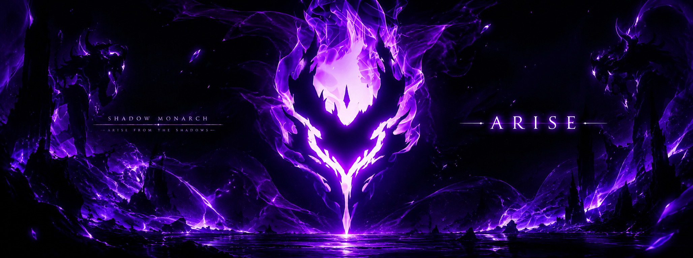

# Hey, I'm Chaitanya 👋

### ⚡ AN INVENTOR OF THE INEVITABLE.

I'm a developer, creator, and curious mind who loves turning random ideas into real things.

I enjoy experimenting with technology, building digital experiences, exploring interactive worlds, and bringing ideas to life that start with a simple **"What if?"**

I don't just want to use technology. I want to discover new ways to use it.

---

### 🧠 A Little About Me

- 💻 Building web applications and digital experiences
- 🎮 Exploring game development and interactive worlds
- 🤖 Experimenting with AI and emerging technologies
- 🛠️ Learning by building, debugging, and improving
- 🌌 Curious about ideas that seem impossible until someone creates them
- 🚀 Always exploring. Always experimenting. Always building.

---

## ⚔️ MY DEVELOPER ARSENAL

  <b>「 FULL-STACK • AI/ML • GAME DEVELOPMENT 」</b>

### 🎨 FRONTEND & UI

  
  
  
  
  
  
  

### ⚙️ BACKEND & APIs

  
  
  
  
  
  

### 💻 PROGRAMMING LANGUAGES

  
  
  
  
  
  
  

### 🧠 AI / MACHINE LEARNING / COMPUTER VISION

  
  
  
  
  

### 🤖 LLMs / GENERATIVE AI / AGENTS

  
  
  
  

### 🗄️ DATABASES & DATA

  
  
  
  
  

### 📱 MOBILE DEVELOPMENT

  
  
  

### 🎮 GAME DEVELOPMENT

  
  
  
  
  
  

### ☁️ CLOUD / DEVOPS / DEVELOPER TOOLS

  
  
  
  
  
  
  
  

### 🧪 TESTING & ENGINEERING

  
  
  
  

---

---

## 👑 FEATURED PROJECTS

  <i>「 Ideas are everywhere. Building them is the difference. 」</i>

<table>
<tr>
<td width="50%" valign="top">

### 🤖 AgentForge

**AI-Powered Software Engineering Workspace**

A multi-agent AI platform designed to support software planning, implementation, testing, code review, and debugging.

**Stack:** Next.js · TypeScript · FastAPI · LangGraph · Gemini · PostgreSQL · Docker

</td>
<td width="50%" valign="top">

### 🗺️ Atlas Go

**Geospatial Exploration Platform**

An interactive mapping experience combining geospatial visualization, temporal replay, spatial indexing, and privacy-conscious local data handling.

**Stack:** Next.js · React · MapLibre · OpenStreetMap · Uber H3

</td>
</tr>
<tr>
<td width="50%" valign="top">

### 📱 C_GAINS

**Fitness & Performance Platform**

A cross-platform fitness app focused on workout tracking, nutrition planning, exercise discovery, and progress analytics.

**Stack:** Flutter · Dart · Riverpod · Drift · SQLite

</td>
<td width="50%" valign="top">

### 👁️ Smart CCTV Crowd Management

**AI & Computer Vision**

A computer-vision project focused on CCTV monitoring, crowd analysis, and automated surveillance support.

**Stack:** Python · TensorFlow · OpenCV · Node.js · Express

</td>
</tr>
<tr>
<td width="50%" valign="top">

### ✈️ Airfare Price Prediction

**Machine Learning & Data Science**

A machine-learning pipeline using data preprocessing, feature engineering, and regression models to estimate airfare prices.

**Stack:** Python · Pandas · Scikit-learn · NumPy

</td>
<td width="50%" valign="top">

### 🌐 Developer Portfolio

**Interactive Developer Experience**

A personal portfolio featuring project discovery, a command-driven console, responsive UI, and a custom animated scene.

**Stack:** Next.js · TypeScript · React · CSS · Vercel

</td>
</tr>
</table>

### 🎮 GAME DEVELOPMENT LAB

Building immersive environments, cinematic scenes, and gameplay experiences with Roblox Studio, while exploring Unity and Unreal Engine.

---

If an idea sounds interesting enough, there's a good chance I'll try building it.

⭐ Thanks for stopping by. Explore my repositories and see what I'm creating!

---

  <a href="https://www.linkedin.com/in/chaitanya-jidigum-082091268/">
    <img src="https://img.shields.io/badge/LinkedIn-Connect-0D1117?style=for-the-badge&logo=linkedin&logoColor=0A66C2
